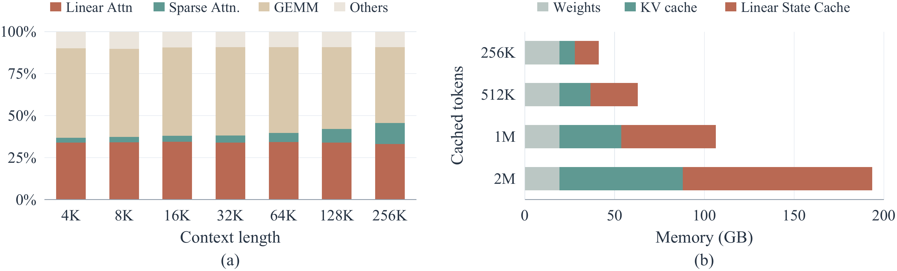
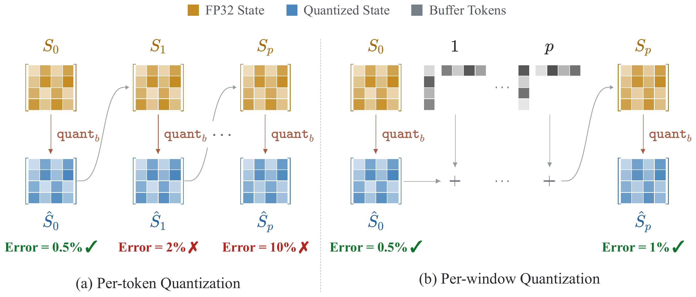
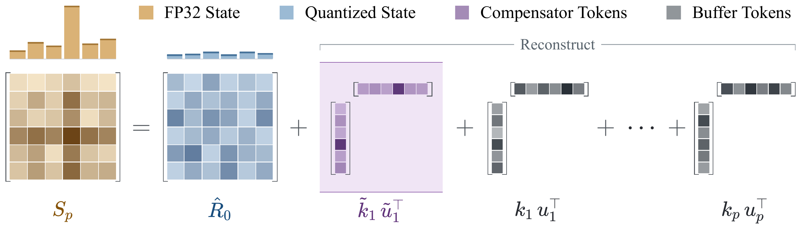
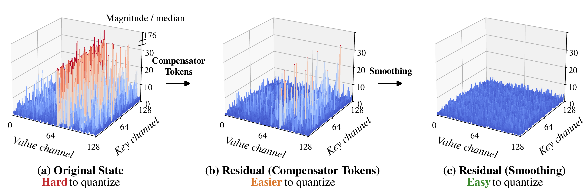
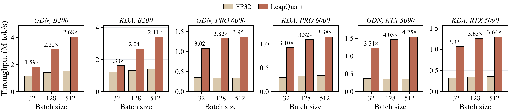
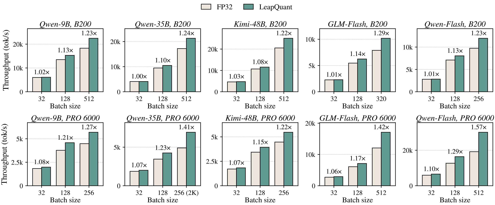
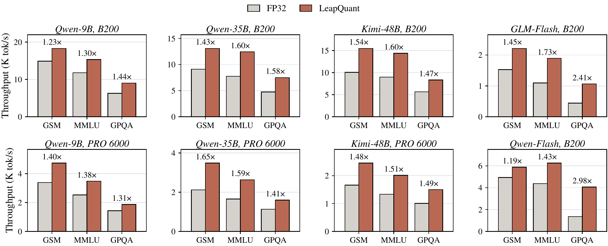

<div align="center">

# LeapQuant

**Efficient Linear Attention with Accurate Recurrent State Quantization**

<p>
  <a href="https://arxiv.org/abs/2609.38166"></a>
  <a href="https://leapquant.github.io"></a>
  <a href="https://github.com/leapquant/LeapQuant"></a>
</p>

</div>

> **Near-lossless 8-bit recurrent states, training-free.** LeapQuant quantizes the recurrent state of linear attention models in the Qwen, Kimi, and GLM families, achieving average speedups of **2.05–3.70×** at the kernel level and **1.57×** end to end.

## 🔥 News

- [2026/11] LeapQuant is open-sourced!

## 📚 About

Recent LLMs replace many standard attention layers with linear attention, such as Gated DeltaNet (GDN) and Kimi Delta Attention (KDA). Linear attention compresses the context into a fixed-size recurrent state, but reading and updating that state at every decoding step remains a major inference bottleneck.

<p align="center"></p>

Quantization is a natural way to reduce this cost, but it can significantly degrade model quality. Rounding errors accumulate across decoding steps, and outlier rows and columns in the state make each quantization step inaccurate. LeapQuant addresses both problems with three training-free techniques:

- **Per-window quantization** limits error accumulation by quantizing the state only once per window of tokens.
- **Compensator Tokens** keep the state's largest outliers in high precision.
- **Residual smoothing** balances the remaining residual before quantization.

## 🧠 Method

### ① Per-window quantization

To limit error accumulation, LeapQuant *leaps* over a window of tokens and quantizes the state only once, at the end of the window. Within the window, the low-bit state stays fixed, token updates are buffered in high precision, and each output is computed from the fixed state together with the buffered updates.

<p align="center"></p>

### ② Compensator Tokens

To reduce the error of each quantization step, LeapQuant keeps the state's largest outliers in high precision as a few *Compensator Tokens*. Each one is a rank-one outer product, the same form as a real-token update, so it shares the window's update path at almost no extra cost.

<p align="center"></p>

### ③ Residual smoothing

After the Compensator Tokens are removed, the residual can still have uneven magnitudes across key channels. LeapQuant rescales each key row before quantization to balance these magnitudes. The smoothing scales are recomputed at every window boundary.

<p align="center"></p>

## 🚀 Results

With accuracy comparable to the FP32 baseline, LeapQuant achieves average speedups of **2.05–3.70×** at the kernel level and **1.57×** for end-to-end inference on NVIDIA B200, RTX PRO 6000, and RTX 5090 GPUs.

🎯 **Accuracy** (%) on AIME 2026, BeyondAIME (Beyond), GPQA-Diamond (GPQA), and LiveCodeBench v6 (LCB):

<div align="center">

<table>
<thead>
<tr><th rowspan="2">Method</th><th colspan="4">Qwen3.5-9B</th><th colspan="4">GLM-5.3-Flash</th><th colspan="4">Qwen3.8-Flash-Next</th><th rowspan="2">Avg.</th></tr>
<tr><th>AIME</th><th>Beyond</th><th>GPQA</th><th>LCB</th><th>AIME</th><th>Beyond</th><th>GPQA</th><th>LCB</th><th>AIME</th><th>Beyond</th><th>GPQA</th><th>LCB</th></tr>
</thead>
<tbody>
<tr><td>FP32</td><td>87.9</td><td>63.3</td><td>81.3</td><td>64.1</td><td>92.2</td><td>80.7</td><td>92.1</td><td>85.2</td><td>98.5</td><td>85.1</td><td>91.4</td><td>86.8</td><td>84.0</td></tr>
<tr><td>BF16</td><td>72.1</td><td>33.7</td><td>66.2</td><td>49.6</td><td>76.7</td><td>57.2</td><td>90.6</td><td>74.6</td><td>96.8</td><td>78.8</td><td>90.2</td><td>84.0</td><td>72.5</td></tr>
<tr><td colspan="14" align="center"><i>8-bit methods</i></td></tr>
<tr><td><b>LeapQuant</b></td><td><b>87.9</b></td><td><b>64.0</b></td><td><b>81.8</b></td><td><b>64.1</b></td><td><b>91.1</b></td><td><b>83.2</b></td><td><b>91.2</b></td><td><b>87.5</b></td><td><b>99.0</b></td><td><b>85.3</b></td><td><b>91.6</b></td><td><b>85.8</b></td><td><b>84.4</b></td></tr>
<tr><td>FP8</td><td>0.0</td><td>0.1</td><td>2.2</td><td>5.9</td><td>69.6</td><td>44.2</td><td>82.0</td><td>53.2</td><td>82.5</td><td>52.8</td><td>76.8</td><td>71.5</td><td>45.1</td></tr>
<tr><td>INT8</td><td>3.9</td><td>1.8</td><td>17.2</td><td>10.7</td><td>87.4</td><td>66.8</td><td>90.4</td><td>67.4</td><td>67.5</td><td>41.8</td><td>61.3</td><td>56.0</td><td>47.7</td></tr>
<tr><td>KVQuant</td><td>70.3</td><td>39.9</td><td>66.8</td><td>55.5</td><td>87.9</td><td>72.8</td><td>90.6</td><td>83.0</td><td>94.7</td><td>74.2</td><td>87.2</td><td>79.9</td><td>75.2</td></tr>
<tr><td>QuaRot</td><td>11.4</td><td>7.4</td><td>38.2</td><td>35.6</td><td>91.0</td><td>76.2</td><td>90.9</td><td>78.6</td><td>88.3</td><td>61.0</td><td>84.7</td><td>72.0</td><td>61.3</td></tr>
<tr><td>TurboQuant</td><td>67.9</td><td>43.2</td><td>62.0</td><td>42.2</td><td>83.8</td><td>67.3</td><td>89.9</td><td>73.8</td><td>95.4</td><td>78.4</td><td>89.9</td><td>84.7</td><td>73.2</td></tr>
<tr><td colspan="14" align="center"><i>6-bit methods</i></td></tr>
<tr><td><b>LeapQuant</b></td><td><b>87.9</b></td><td><b>63.6</b></td><td><b>81.0</b></td><td><b>65.4</b></td><td><b>92.9</b></td><td><b>82.7</b></td><td><b>91.2</b></td><td><b>86.3</b></td><td><b>98.8</b></td><td><b>85.8</b></td><td><b>89.9</b></td><td><b>86.8</b></td><td><b>84.4</b></td></tr>
<tr><td>TurboQuant</td><td>19.3</td><td>7.2</td><td>33.2</td><td>13.0</td><td>88.1</td><td>66.8</td><td>88.0</td><td>66.2</td><td>94.4</td><td>73.1</td><td>88.2</td><td>83.7</td><td>60.1</td></tr>
<tr><td>MXFP6</td><td>0.0</td><td>0.0</td><td>0.8</td><td>0.5</td><td>71.4</td><td>44.8</td><td>82.7</td><td>53.4</td><td>59.2</td><td>34.6</td><td>63.3</td><td>58.0</td><td>39.1</td></tr>
<tr><td>NVFP6</td><td>0.0</td><td>0.1</td><td>1.5</td><td>7.6</td><td>39.2</td><td>17.1</td><td>67.8</td><td>36.9</td><td>80.4</td><td>52.9</td><td>73.7</td><td>67.4</td><td>37.1</td></tr>
<tr><td colspan="14" align="center"><i>4-bit methods</i></td></tr>
<tr><td><b>LeapQuant</b></td><td><b>85.0</b></td><td><b>60.1</b></td><td><b>80.0</b></td><td><b>61.3</b></td><td><b>85.7</b></td><td><b>69.0</b></td><td><b>91.4</b></td><td><b>75.3</b></td><td><b>98.6</b></td><td><b>83.8</b></td><td><b>91.6</b></td><td><b>85.8</b></td><td><b>80.6</b></td></tr>
<tr><td>TurboQuant</td><td>3.5</td><td>1.4</td><td>26.8</td><td>11.5</td><td>59.7</td><td>43.2</td><td>77.9</td><td>49.4</td><td>79.3</td><td>49.8</td><td>74.9</td><td>62.8</td><td>45.0</td></tr>
<tr><td>MXFP4</td><td>0.0</td><td>0.0</td><td>3.7</td><td>0.3</td><td>25.3</td><td>18.6</td><td>70.9</td><td>29.3</td><td>1.7</td><td>2.8</td><td>25.4</td><td>22.6</td><td>16.7</td></tr>
</tbody>
</table>

</div>

⚙️ **Kernel throughput** of one linear attention layer:

<p align="center"></p>

⚡ **Decode throughput** in vLLM at context length 4K:

<p align="center"></p>

🌐 **End-to-end throughput** in vLLM:

<p align="center"></p>

## 🛠️ Usage

LeapQuant is integrated into vLLM 0.30.0 as a plugin and supports the Qwen (Gated DeltaNet) and GLM (Kimi Delta Attention) models.

```bash
git clone https://github.com/leapquant/LeapQuant.git
cd LeapQuant && pip install -e .

bash serve.sh <model>
```

`serve.sh` starts an OpenAI-compatible vLLM server with 8-bit recurrent states; extra arguments are passed to `vllm serve`.

## 📝 Citation

```bibtex
@article{pan2026leapquant,
  title   = {LeapQuant: Efficient Linear Attention with Accurate Recurrent State Quantization},
  author  = {Pan, Yi and Xi, Haocheng and Zhu, Kan and Li, Xingyang and Wu, Yibo and Mishra, Mayank and
             Zhang, Hongtao and Zheng, William X. and Kasikci, Baris and Han, Song and Keutzer, Kurt and
             Iyer, Rishabh and Stoica, Ion},
  journal = {arXiv preprint arXiv:2609.38166},
  year    = {2026}
}
```

## 🙏 Acknowledgement

LeapQuant is built on [vLLM](https://github.com/vllm-project/vllm), [TileLang](https://github.com/tile-ai/tilelang), and [Flash Linear Attention](https://github.com/fla-org/flash-linear-attention). We also extend our thanks to the Kernel Design Agents (KDA) team for co-evolving the kernels for LeapQuant.
